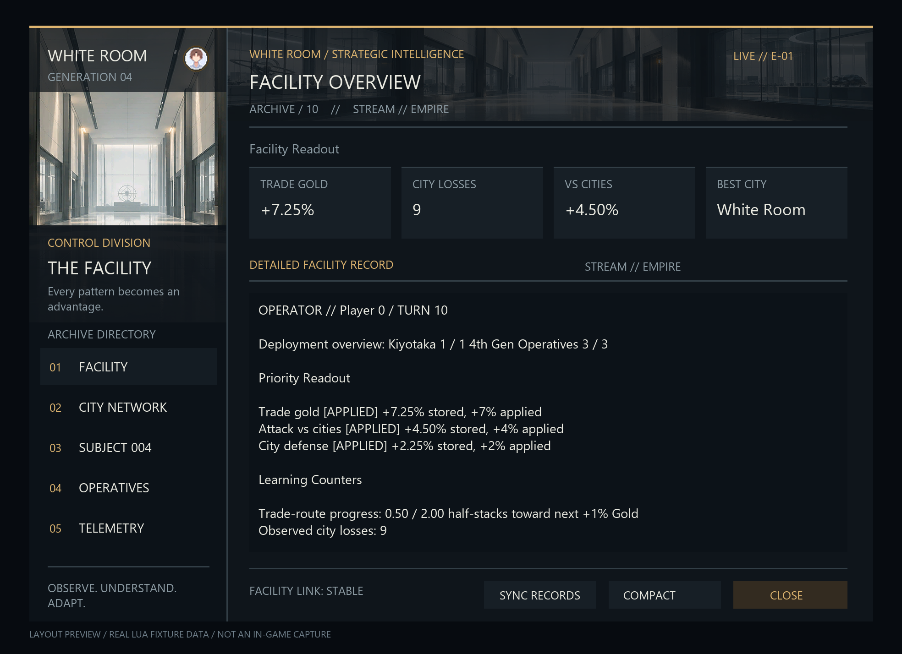
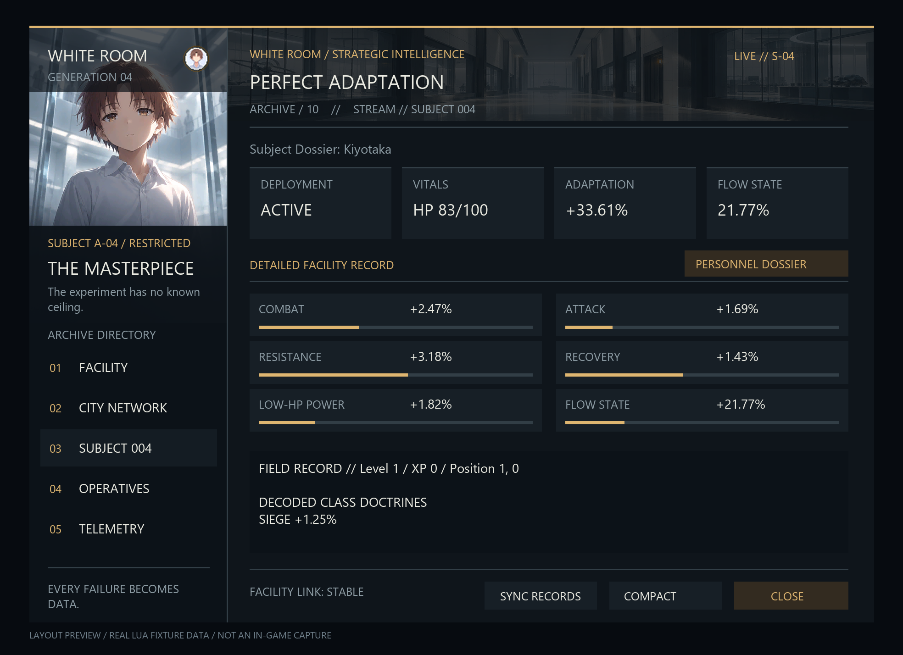
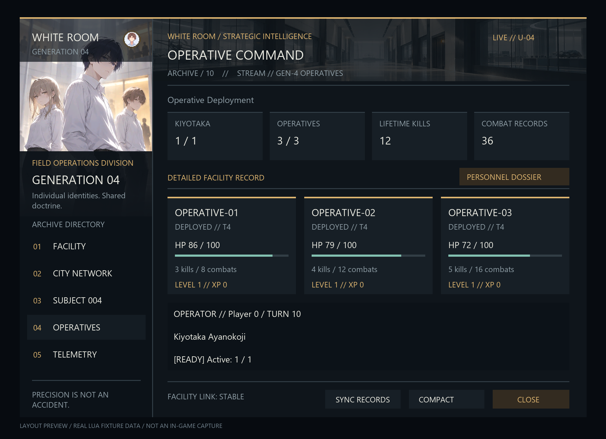
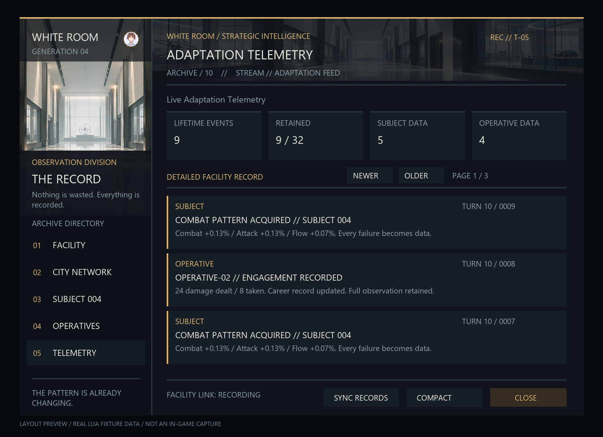
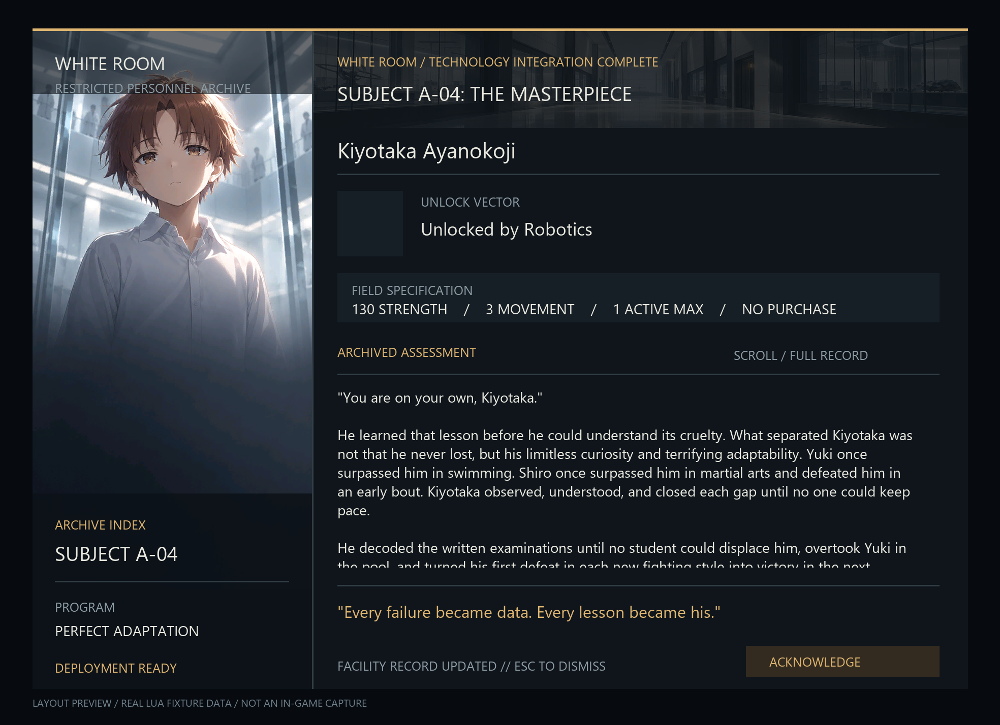
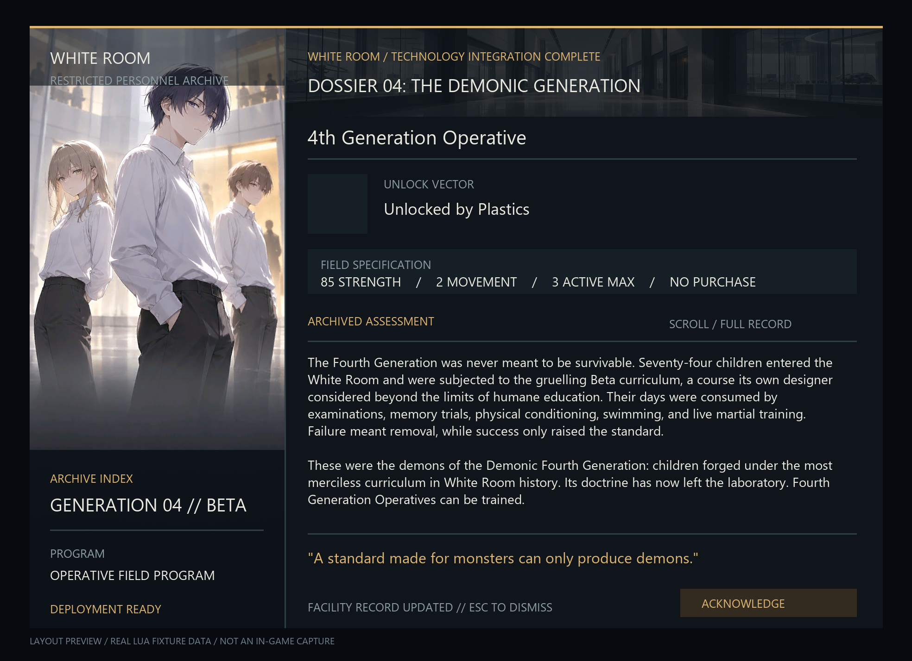

# Restricted Archive UI

This is a presentation-only redesign. No gameplay Lua, SQL, balance values, unit
identity rules, or existing progression keys were changed.

## Presentation

- 920 x 650 archive canvas, replacing the ornate stock teal/gold window chrome
  with graphite surfaces, ivory labels, restrained amber accents and native hover
  highlights. It fits the same desktop-scale use case as the previous window.
- Illustrated navigation rail with a distinct Subject 004 and Generation 04
  identity. The facility and city/telemetry pages share architectural artwork.
- Kiyotaka has six visual meters. Combat, attack, resistance and low-HP power
  show progress within the next applied promotion tier; recovery shows the next
  whole-percent threshold; Flow State shows progress toward 100%. Stored values
  are not capped by the meters.
- Three Operative cards read the existing persistent callsigns and actual unit
  health, level, XP, kills and combats. Empty slots are explicitly vacant, and
  extended statistics remain available in tooltips and the scrollable record.
- Telemetry pages show three records each, including category, turn and record
  number. Tooltips retain full headlines/details; all retained records can be
  paged through. Compact mode retains the legacy text presentation.
- Illustrated unlock dossiers use scrollable lore rather than fixed-height
  paragraphs. Live unit stats are read from GameInfo. Existing seen flags remain
  intact; the Personnel Dossier button can replay an unlocked dossier without
  changing those flags or notifying again. Locked technologies stay classified.
- Flavor banners use a portrait strip and the same visual palette.

The status panel is read-only. There are no new per-frame unit/city scans,
SaveData writes or animated effects. Idle banner queue reads remain throttled to
0.5 seconds; only active banner timing runs each frame. The existing lightweight
diplomacy visibility poll remains, and section textures are changed only when
the artwork actually changes. Active-player changes dismiss stale dossiers.

## Original artwork

Three new paintings were generated with the built-in image generation tool:
an empty White Room observation facility, Kid Kiyotaka's clinical portrait, and
the Fourth Generation Operative group. Existing character icons and Dawn of Man
art served as character/style references; they were not overwritten.

- Original PNG paintings: `Art/UI/Source/`.
- Full prompts and tool provenance: [`Art/UI/ART_PROMPTS.json`](Art/UI/ART_PROMPTS.json).
- Runtime textures: six `Art/UI/WR_UI_*.dds` files, approximately 2.4 MiB total,
  block-aligned and DXT5-compressed; imported into VFS by the project/manifest.
- `python tools/build_ui_art.py` rebuilds DDS crops from the saved originals.
  No generation service or extra image processing runs in the game.

## Verification and previews

Install `requirements-dev.txt`, then run:

```powershell
python tools/sync_modinfo.py
python tools/validate_mod.py
python tools/preview_ui.py
```

The validator compiles every Lua file using Lua 5.1 and executes the actual UI
Lua against strict controls taken from its XML. Tests cover navigation, compact
mode, fractional values, meter overflow, persistent callsigns, vacant slots,
telemetry paging/empty feeds, unlock art, replay save safety, foreign-civilization
privacy, active-player changes and idle SaveData polling. Existing gameplay,
SQL, package/hash and Community Patch dependency tests remain in place.

The previews below are rendered from the XML and real Lua fixture state. They
use a substitute desktop font and do not reproduce the Civ V engine's atlas
icons, exact font metrics, scrolling or input system. They are layout QA images,
not in-game screenshots. Final Civ V smoke testing is still needed for textures,
native hover/input, scrolling and interaction with CP/EUI screens. At screen
sizes below 952 x 698, the fixed canvas may not fit comfortably.







